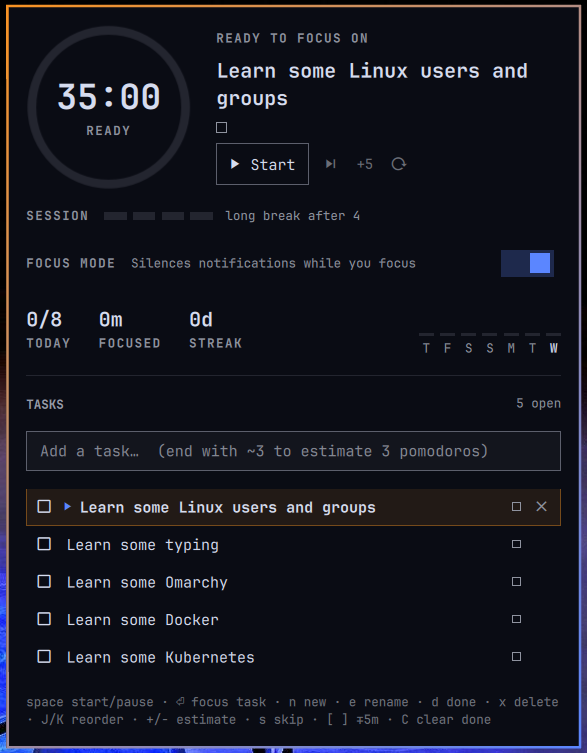

# Pomodoro Task Manager for Omarchy

A pomodoro timer for the [Omarchy](https://omarchy.org) bar with a built-in task list, daily goal, and focus history.



## Features

- **Bar timer**: left-click to start/pause, middle-click to skip, right-click to open the panel
- **Progress ring** with start/pause, skip, +5 minutes and reset (scroll on the ring for ±1 minute)
- **Task list**: type a task, end it with `~3` to estimate 3 pomodoros. Each finished focus session is credited to the active task. Completing a task moves focus to the next open one.
- **Stats**: today's pomodoros against a daily goal, focus time, day streak, and a 7-day chart
- **Session cadence**: dots show progress toward the long break
- **Keeps state across restarts**: tasks, history and a running timer are saved to `~/.local/state/stradjazz.pomodoro/state.json`
- **Notifications** name the task and its progress, with an optional sound
- **Themed**: uses your Omarchy theme colors and corner style, and follows the bar to any edge
- **Works with multiple monitors**: every bar shows the same timer

## Install

```bash
omarchy plugin add https://github.com/Stradjazz/omarchy-pomodoro.git --enable
```

Optional keybindings for `~/.config/hypr/bindings.lua`:

```lua
o.bind("SUPER + CTRL + U", "Pomodoro tasks", "omarchy-shell shell toggle stradjazz.pomodoro")
o.bind("SUPER + CTRL + SHIFT + U", "Pomodoro start/pause", "omarchy-shell stradjazz.pomodoro toggle")
```

Update with `omarchy plugin update stradjazz.pomodoro`.

## Remove

```bash
omarchy plugin remove stradjazz.pomodoro
```

This removes the widget from the bar and deletes the plugin folder. Two things are left for you to delete if you want:

- Your tasks and focus history in `~/.local/state/stradjazz.pomodoro/`: `rm -rf ~/.local/state/stradjazz.pomodoro`
- The two optional keybindings, if you added them to `~/.config/hypr/bindings.lua`

The plugin never edits your configuration files itself. It only writes its own state file.

## Dependencies

Everything it needs ships with Omarchy:

- **Omarchy shell (Quattro / 4.x)**: Quickshell-based bar plugin API
- **`notify-send`** (libnotify): end-of-phase notifications
- **`paplay`** (libpulse, via PipeWire): optional end-of-phase sound, played from the freedesktop sound theme in `/usr/share/sounds/freedesktop/stereo/`. Turn it off with `"sound": false`
- **A Nerd Font**: icons. Omarchy's default font includes them

## Panel keys

| Key | Action | Key | Action |
|---|---|---|---|
| `space` | start / pause | `Enter` | focus on the selected task |
| `j` / `k` | move cursor | `J` / `K` | reorder task |
| `n` | new task | `e` / `F2` | rename |
| `d` | mark done / reopen | `x` / `Del` | delete |
| `+` / `-` | change estimate | `[` / `]` | −/+ 5 minutes |
| `s` | skip phase | `R` | reset timer |
| `C` | clear done tasks | `Esc` | close |

## Settings

Set these on the widget's entry in `~/.config/omarchy/shell.json`:

```json
{ "id": "stradjazz.pomodoro", "workMinutes": 25, "dailyGoal": 8 }
```

| Key | Default | |
|---|---|---|
| `workMinutes` | 25 | focus length |
| `breakMinutes` | 5 | short break |
| `longBreakMinutes` | 15 | long break |
| `longBreakEvery` | 4 | focus sessions before a long break |
| `dailyGoal` | 8 | pomodoros per day |
| `autoStartBreaks` | true | start breaks automatically |
| `autoStartFocus` | true | start focus automatically after a break |
| `sound` | true | play a sound when a phase ends |
| `showTaskInBar` | false | show the current task next to the timer |

## Scripting

```bash
omarchy-shell stradjazz.pomodoro add "Write report ~2"   # add a task
omarchy-shell stradjazz.pomodoro toggle                  # start / pause
omarchy-shell stradjazz.pomodoro skip
omarchy-shell stradjazz.pomodoro extend 10               # minutes, negative to shorten
omarchy-shell stradjazz.pomodoro done                    # finish the active task
omarchy-shell stradjazz.pomodoro status                  # JSON
```

## License

MIT
